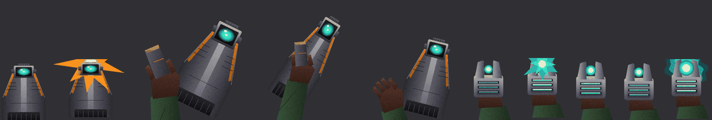

# Vanguard Arsenal

A Marathon 2 plugin that turns two of the standard weapons into faster,
more modern-feeling guns:

| Slot | Becomes | How it plays |
| --- | --- | --- |
| Assault rifle | **Vanguard Burst Rifle** | Every trigger pull fires a 3-round burst; hold to keep firing bursts (about two a second). 36-round magazine, tight spread, harder-hitting rounds. The grenade launcher stays on secondary fire. |
| Fusion pistol | **Plasma Pistol** | Semi-automatic: fires as fast as you click. Each shot builds heat; around 10 quick shots overheat it and it vents for 2.5 seconds, unable to fire. Hold secondary fire to charge a big shot, which also overheats it. A heat gauge shows at the top of the screen. |

Mouse-wheel weapon switching works as usual.

## Installing

1. Copy this whole `Vanguard Arsenal` folder into the `Plugins` folder of
   your Marathon 2 data (next to `Basic HUD`, `Enhanced HUD`, and so on).
2. In Aleph One go to **Preferences → Environment → Plugins** and make sure
   **Vanguard Arsenal** is enabled. Turn it off there to get the original
   weapons back.

### Requirements

- **The magazine size, fire rate, spread and damage changes need this
  branch's Aleph One build**, which lets plugin MML tune weapon triggers
  (`<weapons><trigger .../></weapons>`). On an official Aleph One release
  the plugin still loads; you get the bursts, heat and new art with
  Marathon's stock magazine sizes and fire rates.
- The new art needs an Aleph One with the `ShapesPatch::requires_opengl`
  fix from this branch to show in software / Direct3D 11 mode. Releases
  without it may skip the art there at random.
- The script needs full Lua access, so it can't run alongside another
  plugin that also changes gameplay through Lua, and Aleph One turns off
  achievements while it's active.
- Net games: every player needs the plugin enabled.
- The art is made for 16/32-bit colour (the default in every renderer).
  The 8-bit software colour mode will show the new frames with wrong
  colours.

## Tuning

- Burst size, delay between bursts, heat per shot, cooling and vent time:
  constants at the top of `vanguard.lua`.
- Magazine sizes, fire rate, spread, recoil and projectile:
  `Vanguard Arsenal.mml`.

## Art

All weapon art is original, drawn procedurally by `source/make_art.py`.
To rebuild `vanguard_weapons.shpp` after changing it (needs Python 3 and
Pillow):

    python3 source/make_art.py "<Marathon 2 folder>/Shapes.shpA" <output folder>

The Shapes file is only read for the weapon collection's colour table and
frame placement; none of its pixels are copied. The script also writes a
PNG of every frame and a contact sheet for review.

## License

GPL 3 or later, like Aleph One.
